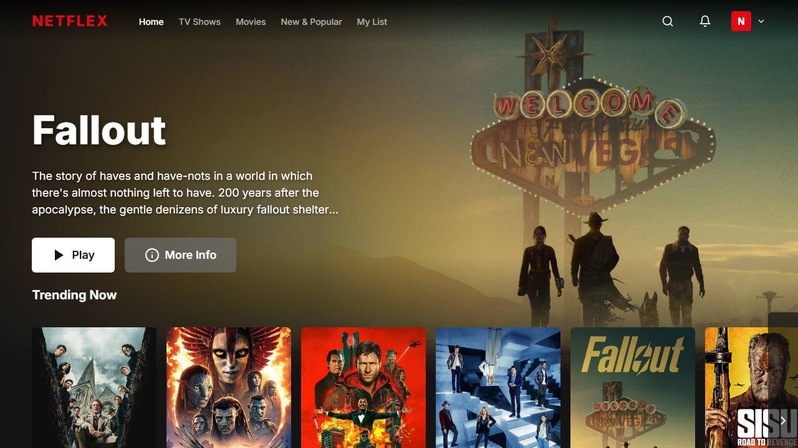
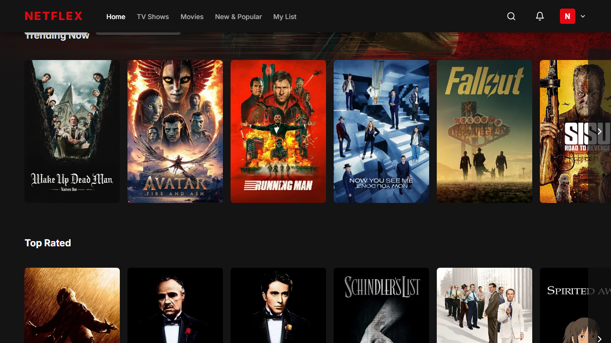
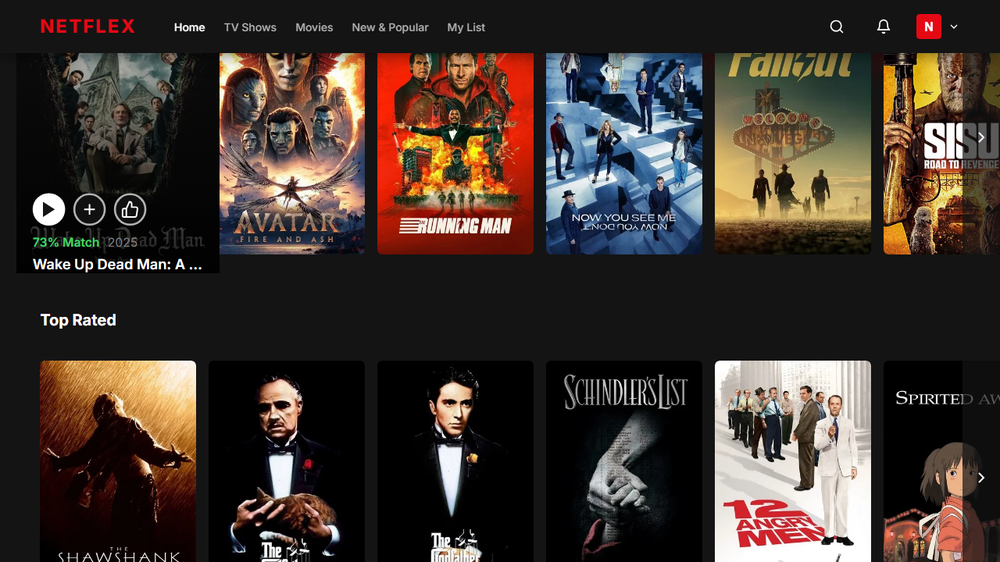
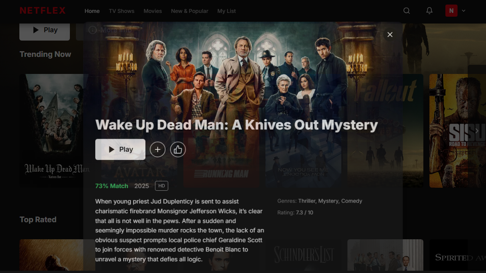

# Netflex 🎬

A modern Netflix clone built with Angular 17, featuring a sleek dark UI, real movie data from TMDB API, interactive movie modals, and comprehensive E2E testing.

## 📸 Screenshots

### Homepage with Hero Banner


### Movie Rows with Hover Effects


### Movie Card Hover State


### Movie Detail Modal


## ✨ Features

- **Modern UI**: Netflix-inspired dark theme with smooth animations
- **Hero Banner**: Dynamic featured content with real movie backdrops
- **Movie Rows**: Horizontal scrolling carousels with hover effects
- **Movie Modal**: Click any movie to see details in a Netflix-style popup
- **Responsive Design**: Works seamlessly on desktop, tablet, and mobile
- **TMDB Integration**: Real movie and TV show data from The Movie Database
- **E2E Testing**: Comprehensive Playwright tests with screenshot capture
- **Docker Support**: Production-ready containerization

## 🚀 Quick Start

### Prerequisites
- Node.js 18+ 
- npm 9+

### Installation

```bash
# Clone the repository
git clone https://github.com/yourusername/netflex.git
cd netflex

# Install dependencies
npm install

# Start development server
npm start
```

Visit `http://localhost:4200` to view the app.

### Docker

```bash
# Build and run with Docker Compose
docker-compose up -d

# View at http://localhost:3000
```

### Run E2E Tests

```bash
# Install Playwright browsers (first time only)
npx playwright install chromium

# Run tests with screenshot capture
npx playwright test

# View test report
npx playwright show-report
```

## 🛠️ Tech Stack

- **Framework**: Angular 17 (Standalone Components)
- **Styling**: CSS Custom Properties, Dark Theme
- **API**: The Movie Database (TMDB)
- **Testing**: Playwright E2E
- **Container**: Docker + nginx

## 📁 Project Structure

```
src/
├── app/
│   ├── components/
│   │   ├── hero-banner/    # Featured content banner
│   │   ├── movie-card/     # Individual movie card
│   │   ├── movie-modal/    # Movie detail popup
│   │   ├── movie-row/      # Horizontal scrolling row
│   │   └── navbar/         # Navigation header
│   ├── services/
│   │   └── tmdb.service.ts # TMDB API integration
│   └── app.component.ts    # Main app composition
├── environments/           # Environment configs
└── styles.css             # Global styles & theme
e2e/
└── app.spec.ts            # Playwright E2E tests
screenshots/               # E2E test screenshots
```

## 📜 License

MIT License - Built for educational purposes.

## 🙏 Credits

- Movie data provided by [TMDB](https://www.themoviedb.org/)
- Inspired by Netflix's user interface
